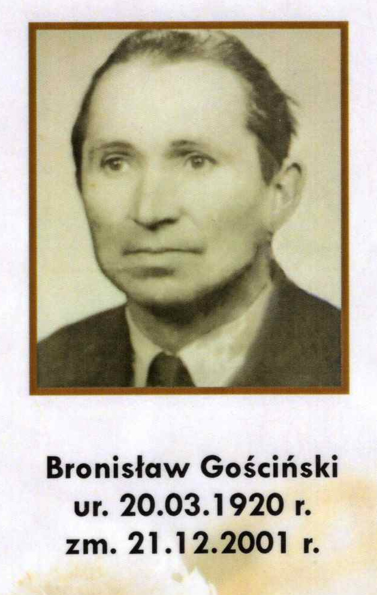
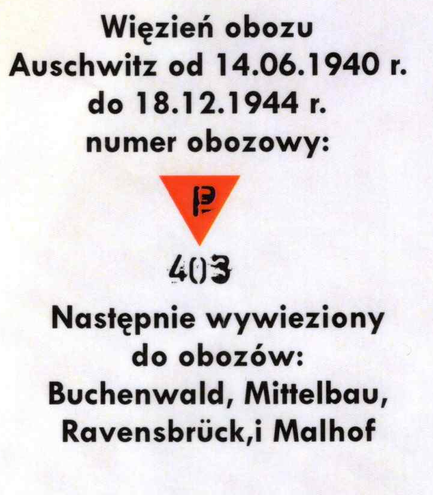

# Bronisław Gościński: Auschwitz History

Bronisław was a son of Jan Gościński and Marianna Gościńska. Explore their branch in the [family-tree viewer](/tree/viewer/) by searching for “Bronisław Gościński” (person 23).

Bronisław Gościński was born on March 20, 1920 in Muszyna. He was the oldest child of Jan Gościński and Marianna Gościńska (maiden name Miczułka). He had three brothers and two sisters. After finishing his education in primary school in Muszyna and secondary school in Nowy Sącz, he worked as a farmer.

On May 3, 1940, Bronisław was arrested by a Gestapo officer while working with his father and was charged with being a member of an illegal underground Polish organization. He was transported to a prison in Nowy Sącz and then one in Tarnów. On June 14, 1940, Bronisław was moved to the concentration camp in Oświęcim (Auschwitz) with the first mass transport of Polish political prisoners. He was given the number 403.

Bronisław’s time in the camp was brutal. He survived one day at a time and worked a variety of jobs, including gardening, harvesting rye, building barracks, making brooms, and handling paperwork in a warehouse. He quickly learned that even the Nazis needed skilled workers to maintain and expand the camp. His prior work experience and ability to learn new skills helped him avoid some of the most dangerous jobs and conditions, increasing his chances of survival. He also spoke German, which further increased his standing as a useful prisoner.

Bronisław had to learn how to make connections, get more food and avoid beatings in order not to die of exposure or exhaustion. He had to keep any extra food and privileges hidden from the Nazis to avoid confiscation and punishment.

His number, 403, also played a part in how he was treated in the camp. He was considered a “STARY NUMER”, an “OLD NUMBER”. Both the prisoners and the Nazis knew that a person who survived in the camp since its early days had to know their way around the place and was worth keeping around.

After a few years in the camp, Bronisław was considered one of the essential people who were not to be transported to any other death camps. He and some others managed to get a relatively safe job in a warehouse. This meant that they were working inside, alleviating dangers of exposure, and gave them access to all sorts of goods to steal to make life a bit easier. At a certain point, Bronisław was trusted enough to be sent outside the camp to do certain tasks for the Nazis in the surrounding towns. He loaded and transported supplies and tools. SS officers usually accompanied them when they left the camp, but on some occasions they were left alone, giving him a chance to escape. He chose not to risk it.

Bronisław stayed in Oświęcim (Auschwitz) until December 18, 1944. After that he was moved to camp Buchenwald, where he worked in a quarry, then to camp Mittelbau, where he worked in an underground factory for V-1 (bomb) and V-3 (cannon). On April 1, 1945, he was transported via train to camp Ravensbrück. The journey itself took 13 days. The train drove in circles and stopped several times before reaching the camp. The prisoners on the train were loaded into cargo carriages, 50 people per carriage. They had to stand the entire time as there was very little space. Bronisław managed to make himself a makeshift hanging bed out of a blanket, which helped him survive the journey as he was sick.

At that time, the front lines were getting closer and they could hear fighting on both sides. It was clear that Germany was losing control and the situation was getting quite chaotic. Bronisław stayed in Ravensbrück until the end of April. The prisoners were then gathered in groups of 500 and told that they had been released and that the Nazis had been ordered to take them to the Americans. They walked for days, sleeping in abandoned homes along the road. Bronisław and a few others separated from the group and managed to escape, but they were caught again soon after.

Bronisław was taken to camp Mallhof, where he spent his final days as a prisoner. One morning all the Nazis suddenly gathered and left the camp, fleeing the Russian army. They left the prisoners unsupervised and the gate open. A rumor spread among the prisoners that an ammunition store beneath the camp could explode at any moment, which was why the Nazis had left so quickly. Bronisław and many others took whatever might be useful and left the camp.

The only way they could go for now was further west. Along the way they met the Russian soldiers who helped some of the sick and wounded, however, they did not tell Bronisław, or anyone else for that matter, where to go or what to do. They stayed in the area for some time and met a Polish man from a local militia. He told Bronisław that they could stay in the houses previously occupied by the Nazis. Compared with the camps, the house offered decent beds, a stocked kitchen, and food and water. Bronisław’s goal was, of course, to go back home, but he decided to stay in one of the Nazi houses for a while in order to regain strength for the journey.

After a few days, Bronisław and five others started walking home. Along the way they witnessed the destruction caused by the war. Russian soldiers stopped and robbed them several times, but they continued. With help from a man with a car they eventually made it to Szczecin. At the border, they were forced to work for the Russians for 10 days. After that, they were released and managed to take a train going further into Polish territory.

After traveling by train, truck, horse-drawn carriage, and on foot, Bronisław made it back to Muszyna on June 1, 1945. The first thing he did was enter his local church. It was his first time inside a church in five years; prisoners had not been allowed to practice their faith. He tried to stay unnoticed, but the people recognized him and escorted him home. Bronisław survived and was reunited with his family.

The narrative above and the card below use different spellings for the final camp: “Mallhof” and “Malhof.” The identification remains unresolved.

## Prisoner card and translation

The card is translated as follows:

> Prisoner of the Auschwitz camp from 14.06.1940 to 18.12.1944, camp number: [P] 403. Subsequently deported to the camps: Buchenwald, Mittelbau, Ravensbrück, and Malhof.

A couple of notes on the details: the red triangle with the letter "P" was the badge marking Polish political prisoners in Nazi concentration camps (the letter indicated nationality, the color indicated the prisoner category). The chain of camps listed — Buchenwald, Mittelbau, Ravensbrück, and what looks like "Malhof" — records that Bronisław spent over four years at Auschwitz before being transferred elsewhere as the camp system was evacuated later in the war.

## Auschwitz Memorial reference

The [Auschwitz Memorial’s list of the first transport of Polish prisoners, June 14, 1940 (PDF)](https://www.auschwitz.org/gfx/auschwitz/userfiles/_public/2020_news/lista_wiezniow_i_transportu_polakow_do_auschwitz_14_czerwca_1940.pdf) lists **Bronisław Gościński, prisoner 403**, born March 20, 1920 in Muszyna. Entry 403 on PDF page 23 also records his transfer to Buchenwald in 1944 and says he survived the war.

This supports the name, birth details, prisoner number, and Buchenwald transfer shown in the family material. The card supplies the exact Auschwitz dates and the additional camp names; the Memorial’s summary does not establish every detail of the narrative above.
