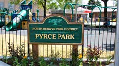

# Leona Pyrce and Pyrce Park

Leona Pyrce was recognized as one of the founders of the North Berwyn Park District when Pyrce Park was named in her honor in July 1996. The park is at 16th Street and Wesley Avenue in Berwyn, Illinois.

The Pyrce Park sign. Photo: North Berwyn Park District, [Summer 2016 brochure, page 38](https://uploads-ssl.webflow.com/57acf000e18710ca1643be74/593f444d40510639b8b5b033_2016SummerBrochure.pdf#page=38).

The district records Leona’s recognition in the history section of its [Pyrce Park page](https://www.nbpd4fun.org/pyrce-park).
