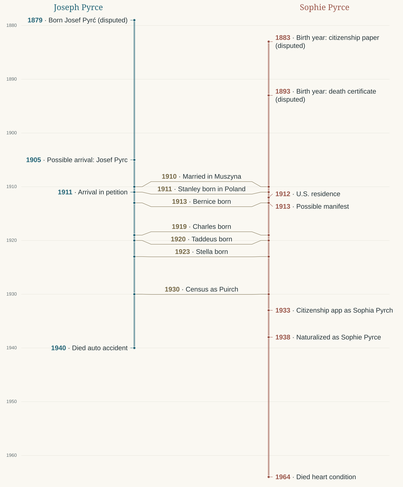

# The Pyrce family in America

Józef (Joseph) Pyrć and Zofia (Sophie) Gościńska came from Muszyna, in the
historical region of Galicia, then part of Austria-Hungary and now in southern
Poland. Polish records in this collection use the spellings **Pyrć** and **Pyrc**. The accented **ć** is a different Polish letter from **c**; the spellings should not be treated as having identical pronunciation. See the [surname notes](/names/pyrc/) for the distinction.

[Open the timeline full size](./joseph_sophie_timeline_vertical.svg){target="_blank"}

## US Census, 1930

The 1930 U.S. Census (enumerated
April 15, 1930; sheet 19-A, enumeration district 16-824, household at 2406 S.
Spaulding Ave.) records the family as **Puirch**. It lists Joseph, Sophie, and
five children. Joseph’s occupation is recorded as laborer in a steel factory;
Sophie’s as laborer in a pie factory. “Puirch” may be a spelling used by the
family or an enumerator’s invention.
View the [1930 census image](../../media/SophieJoseph/1930%20-%20Census%20as%20Puirch.jpg).

No credible 1920 Census household for Joseph and Sophie has been found.

## Possible naturalization records for Joseph

The [Cook County naturalization declarations database](https://services.cookcountyclerkofcourt.org/nr/) contains possible matches. Neither entry below has been established as Joseph’s record. A declaration of intention was a step in the naturalization process, not proof that citizenship was granted.

| Name in the index | Details in the entry | Why the identification is uncertain |
| --- | --- | --- |
| Frank Pyrch | “Musina,” “Poland - Austria”; born 1884; arrived 1897; declaration dated 1917 | The birthplace and surname may be relevant, but the given name, birth year, and arrival year differ from the family accounts. |
| Josef Pyrcioch | “Lagorzany,” “Austria”; born 1894; arrived 1911; declaration dated 1915 | The given name and reported arrival year match, but the surname, birth year, and birthplace differ. “Lagorzany” may be a reading of “Zagorzany”; this has not been confirmed. |

The second entry gives an address of 1346 Walton St., Chicago. The name and address are research clues, not sufficient evidence to identify the person as Joseph.

## Sophie’s 1933 citizenship papers

In her 1933 “Statement of Facts to Be Used in Filing My Petition for
Citizenship,” Sophie gives her name as **Sophia Pyrch**, her residence as 2406
S. Spaulding Ave., and her continuous U.S. residence as beginning in May 1912.
She says she married Joseph in Muszyna on March 12, 1910, and that he arrived
in the United States in 1911. The form gives Joseph’s birth date as March 8,
1881; other family records give 1879, so the timeline retains 1879 as an
unresolved family date.

The statement lists five children. The handwritten entries give these dates
and places of birth (some handwriting is difficult to read):

| Name as written | Date and place in the statement | Polish form or family name |
| --- | --- | --- |
| Stanley John | November 5, 1911, Poland | Stanisław |
| Bernice Rose | August 1, 1914, Chicago | Bronisława |
| Charles Lewis | May 4, 1919, Chicago | Karol |
| Taddeus Matthew | February 19, 1920, Chicago | Tadeusz |
| Stella | June 16, 1923, Chicago | Stefania |

The statement uses Americanized forms alongside the Polish names. Some dates differ from the charts: Karol’s birth year is 1917 in the tree but 1919 for Charles in this statement; Bronisława’s is 1913 in the tree but 1914 for Bernice here. These conflicting accounts are retained.

Sophie was naturalized on March 22, 1938. The [reverse of her naturalization record](../../media/SophieJoseph/1938%20-%20Naturalization%20-%20Back.tif)
records a name change to **Sophie Pyrce**. The
family was at 2406 S. Spaulding when Sophie filed her 1933 statement; a later
family note places them at 4307 S. Sawyer Ave. 

## Stanley Pyrce records

Stanley was the first son. His [1941 naturalization court card](../../media/SophieJoseph/1941%20-%20Stanley%20Pyrce%20Court%20Naturalization%20Card.jpg) records him as **Stanley Pyrce** and gives May 20, 1941, as the date of admission. The card is reproduced in this collection.

A 1943 pay envelope from the Crane Company exists and gives his name as "Stanley Pyrc." This may
reflect a spelling used when he began working there, possibly more than ten
years earlier.

His military service record, beginning in January 1944, gives
his name as "Pyrce."  (It also says that he was born in the US, but given other documents saying 
he was born in Poland and the existence of the naturalization card, this seems incorrect.)

- [1943 pay envelope](https://archive.pyrce.org/#album=1BBN0wvrVgRiKfmurPiiYDShYqHR3hoyI&photo=1RwdAX1K6FQ6R59PHhA3gqM8LM0_K-Rx1)
- [1944 military service record](https://archive.pyrce.org/#album=1BBN0wvrVgRiKfmurPiiYDShYqHR3hoyI&photo=1Ww_jruBHIoVC6f8dvYVI-lkqz9Regz-V)

## How did the name come to be "Pyrce"?

|Name|Date|Record|
|----|----|------|
|Pyrć|1910s|Polish records|
|Pyrcioch|1915|Possible Naturalization Declaration of Intention|
|Puirch|1930|Census; may be an error|
|Pyrch|1933|Citizenship application|
|Pyrce|1938|Naturalization, name change|
|Pyrc|1943|Stanley's pay envelope; may represent earlier name|
|Pyrce|1944|Stanley's military service certification|

The surviving records use several spellings. Sophie’s 1938 naturalization record documents the spelling **Sophie Pyrce**, while Stanley’s records show both **Pyrce** and **Pyrc** in later years. The reasons for the other variations remain uncertain.

Ted Pyrce attributed the name change to embarrassment over the name sounding “like the fish.” This is a family recollection, rather than an explanation established by the documents.

## Immigration records and unresolved conflicts

- The 1913 passenger manifest for the S.S. *Kaiser Wilhelm II*, sailing from Bremen and arriving February 4, 1913, has an entry for Zofia Goscinska, age 18. It gives Muszyna as her last residence, names Jozef Goscinski as the husband she was joining, and gives Sioux City, Iowa, as her destination. Some details are similar, but they do not align with Sophie’s 1933 statement: she gives May 1912 as the start of continuous U.S. residence and says she married Joseph Pyrć in Muszyna in 1910. The manifest may concern Sophie, but the different husband’s surname, destination, and arrival year leave that identification uncertain. Read [line 2 of the manifest](../../media/SophieJoseph/1913%20-%20Zofia%20Goscinska%20Manifest%20-%20line%202%3F.gif) and its [second page](../../media/SophieJoseph/1913%20-%20Zofia%20Goscinska%20Page%202%20Manifest%3F.gif). The separate ship photograph is captioned “Kaiser Wilhelm III,” which differs from the manifest’s “Kaiser Wilhelm II”; its identification also needs confirmation.

- A separate manifest records Josef Pyrc, age 23, arriving in New York aboard the S.S. *Pretoria* on December 13, 1905. The name and approximate age make him a possible match for Joseph, but the 1933 statement gives Joseph’s arrival as 1911. The 1905 entry should therefore remain a possible earlier arrival, not be assigned to him as fact. View the [1905 manifest, line 5](../../media/SophieJoseph/1905%20-%20Josef%20Pyrc%20Pretoria%20Manifest%3F%20%28line%205%29.gif).

- The [family chart S2, “Gościńscy z Wapiennego,”](/sources/#s2) says "Zofia née Gościńska emigrated to Chicago and married there". That conflicts with Sophie’s own 1933 statement of a 1910 marriage in Muszyna and Stanley’s likely birth in Poland in 1911.

### Sophie’s birth year

The records give different years; the collection retains these alternatives.

|Birth year|Document|
|----------|--------|
|1890|1930 Census gives her age as 40|
|1883|1933 Citizenship Application|
|1883|1938 Naturalization Papers|
|1893|1964 Death Certificate|
|1894-95|Passenger manifest from February 1913; may be different person|

## Record references

- 1930 U.S. census population schedule, Chicago, Cook County, Illinois, sheet
  19-A, enumeration district 16-824, household at 2406 S. Spaulding Ave.;
  [archived census image](../../media/SophieJoseph/1930%20-%20Census%20as%20Puirch.jpg).
- Sophie Pyrch, “Statement of Facts to Be Used in Filing My Petition for
  Citizenship,” 1933, page 3; [archived statement](../../media/SophieJoseph/1933%20-%20Citizenship%20Petition.png).
- S.S. *Kaiser Wilhelm II* passenger manifest, arrival February 4, 1913, line
  2, Zofia Goscinska; [archived manifest](../../media/SophieJoseph/1913%20-%20Zofia%20Goscinska%20Manifest%20-%20line%202%3F.gif).
- S.S. *Pretoria* passenger manifest, arrival December 13, 1905, line 5, Josef
  Pyrc; [archived manifest](../../media/SophieJoseph/1905%20-%20Josef%20Pyrc%20Pretoria%20Manifest%3F%20%28line%205%29.gif).
- Sophie’s naturalization record, reverse, March 22, 1938;
  [archived naturalization reverse](../../media/SophieJoseph/1938%20-%20Naturalization%20-%20Back.tif).
- [Cook County Clerk of the Circuit Court: Naturalization Declarations of Intention](https://services.cookcountyclerkofcourt.org/nr/).
