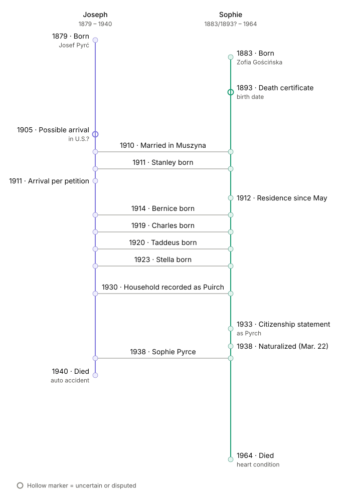

# The Pyrce family in America

Józef (Joseph) Pyrć and Zofia (Sophie) Gościńska came from Muszyna, in the
historical region of Galicia, then part of Austria-Hungary and now in southern
Poland. Polish records show that the original name was "Pyrć", pronounced "pirts".
The diacritic mark over the "c" is one of many used in Polish. It governs pronunciation
and is a distinct letter and sound from a plain "c".

## US Census, 1930

The 1930 U.S. Census (enumerated
April 15, 1930; sheet 19-A, enumeration district 16-824, household at 2406 S.
Spaulding Ave.) records the family as **Puirch**. It lists Joseph, Sophie, and
five children. Joseph’s occupation is recorded as laborer in a steel factory;
Sophie’s as laborer in a pie factory. “Puirch” may be a spelling used by the
family or an enumerator’s invention.
The census image is titled “1930 - Census as Puirch.jpg” in the family archive.

No credible 1920 Census household for Joseph and Sophie has been found.

## Joseph's Naturalization Declaration of Intention?

Joseph might be expected to have become a naturalized citizen first.
The Cook County Clerk of the Circuit Court database of Naturalization Declarations of Intention
has several possible records for Joseph Pyrce.

There is a "Frank Pyrch"
who came from "Musina" in "Poland - Austria", born 1884, arriving 1897, declaration date 1917.
Given the small population of Muszyna, this seems like a strong hint.
This record has the right last name, wrong first name, wrong birth date, and wrong arrival date.
So this seems unlikely.

There is also a "Josef Pyrcioch", from "Lagorzany", "Austria", born 1894, arrivied 1911, declaration
date 1915.  This is the correct first name, a last name pronounced similarly to the Polish, different
birth place (although "Lagorzany" may be "Zagorzany", a very small town in southern Poland), wrong birth date,
correct arrival date.  This is a candidate for yet another spelling (and origin location).
The address listed for this person was 1346 Walton St in Chicago.  This address is now a modern row house,
but it is located next to the Polish Museum of America in Chicago, a curious coincidence.

## Sophie’s 1933 citizenship papers

In her 1933 “Statement of Facts to Be Used in Filing My Petition for
Citizenship,” Sophie gives her name as **Sophia Pyrch**, her residence as 2406
S. Spaulding Ave., and her continuous U.S. residence as beginning in May 1912.
She says she married Joseph in Muszyna on March 12, 1910, and that he arrived
in the United States in 1911. The form gives Joseph’s birth date as March 8,
1881; other family records give 1879, so the timeline retains 1879 as an
unresolved family date.

The statement lists five children. The handwritten entries give these dates
and places of birth (some handwriting is difficult to read):

| Name as written | Date and place in the statement | Polish form or family name |
| --- | --- | --- |
| Stanley John | November 5, 1911, Poland | Stanisław |
| Bernice Rose | August 1, 1914, Chicago | Bronisława |
| Charles Lewis | May 4, 1919, Chicago | Karol |
| Taddeus Matthew | February 19, 1920, Chicago | Tadeusz |
| Stella | June 16, 1923, Chicago | Stefania |

The petition uses Americanized forms alongside the Polish names.

Sophie was naturalized on March 22, 1938. Her naturalization record’s reverse
records a name change to **Sophie Pyrce**. The
family was at 2406 S. Spaulding when Sophie filed her 1933 statement; a later
family note places them at 4307 S. Sawyer Ave. 

## Stanley Pyrce records

Stanley was the first son.
A 1941 Natrualization Court Card documents Stanley Pyrce becoming a naturalized citizen in 1941.
This gives his name s "Pyrce".

A 1943 pay envelope from the Crane Company exists and gives his name as "Stanley Pyrc." This may
reflect a spelling used when he began working there, possibly more than ten
years earlier.

His military service record, beginning in January 1944, gives
his name as "Pyrce."  (It also says that he was born in the US, but given other documents saying 
he was born in Poland and the existence of the naturalization card, this seems incorrect.)

- [1943 pay envelope](https://archive.pyrce.org/#album=1BBN0wvrVgRiKfmurPiiYDShYqHR3hoyI&photo=1RwdAX1K6FQ6R59PHhA3gqM8LM0_K-Rx1)
- [1944 military service record](https://archive.pyrce.org/#album=1BBN0wvrVgRiKfmurPiiYDShYqHR3hoyI&photo=1Ww_jruBHIoVC6f8dvYVI-lkqz9Regz-V)

## How did the name come to be "Pyrce"?

|Name|Date|Record|
|----|----|------|
|Pyrć|1910s|Polish records|
|Pyrcioch|1915|Possible Naturalization Declaration of Intention|
|Puirch|1930|Census; may be an error|
|Pyrch|1933|Citizenship application|
|Pyrce|1938|Naturalization, name change|
|Pyrc|1943|Stanley's pay envelope; may represent earlier name|
|Pyrce|1944|Stanley's military service certification|

The diacritic in the original name was probably lost quickly, since English does not use diacritics.
The name without the diacritic was probably used for a time, but other
forms that more closely mirrored the Polish pronunciation of "Pyrć", "**pirts**",
were either adopted or interpreted by recorders.

The family history shows a willingness to convert Polish names to Americanized versions,
and the record indicates there were several versions of Pyrć before finally settling on
the version with a minimal change, the addition of an "e".  This doesn't sound particularly
American, but it isn't Polish either.
This name was firmly established by 1938.

As a last detail, Ted Pyrce attributed the name change to embarassement over the name sounding "like the fish".

## Immigration records and unresolved conflicts

- The 1913 passenger manifest for the S.S. *Kaiser Wilhelm II*, sailing from Bremen and arriving February 4, 1913, has an entry for Zofia Goscinska, age 18. It gives Muszyna as her last residence, names Jozef Goscinski as the husband she was joining, and gives Sioux City, Iowa, as her destination. This is tantalizingly close, but those details do not align cleanly with Sophie’s 1933 statement: she gives May 1912 as the start of continuous U.S. residence and says she married Joseph Pyrć in Muszyna in 1910. The manifest may concern Sophie, but the different husband’s surname, destination, and arrival year leave that identification uncertain. The source is archived as “1913 - Zofia Goscinska Manifest.gif,” line 2.

- A separate manifest records Josef Pyrc, age 23, arriving in New York aboard the S.S. *Pretoria* on December 13, 1905. The name and approximate age make him a possible match for Joseph, but the 1933 statement gives Joseph’s arrival as 1911. The 1905 entry should therefore remain a possible earlier arrival, not be assigned to him as fact. The image is archived as “1905 - Josef Pyrc Pretoria Manifest? (line 5).gif.”

- The family chart S2, “Gościńscy z Wapiennego,” says "Zofia née Gościńska emigrated to Chicago and married there". That conflicts with Sophie’s own 1933 statement of a 1910 marriage in Muszyna and Stanley’s likely birth in Poland in 1911.

- Sophie’s birth year is not clear.
|Birth year|Document|
|----------|--------|
|1890|1930 Census gives her age as 40|
|1883|1933 Citizenship Application|
|1883|1938 Naturalization Papers|
|1893|1964 Death Certificate|
|1894-95|Passenger manifest from February 1913; may be different person|

### Record references

- 1930 U.S. census population schedule, Chicago, Cook County, Illinois, sheet
  19-A, enumeration district 16-824, household at 2406 S. Spaulding Ave.;
  archived image: “1930 - Census as Puirch.jpg.”
- Sophie Pyrch, “Statement of Facts to Be Used in Filing My Petition for
  Citizenship,” 1933, page 3; archived image: “1933 - Citizenship Petition.png.”
- S.S. *Kaiser Wilhelm II* passenger manifest, arrival February 4, 1913, line
  2, Zofia Goscinska; archived image: “1913 - Zofia Goscinska Manifest.gif.”
- S.S. *Pretoria* passenger manifest, arrival December 13, 1905, line 5, Josef
  Pyrc; archived image: “1905 - Josef Pyrc Pretoria Manifest? (line 5).gif.”
- Sophie’s naturalization record, reverse, March 22, 1938; archived image:
  “1938 - Naturalization - Back.tif.”
- "Illinois, United States records," images, FamilySearch (https://www.familysearch.org/
ark:/61903/3:1:3Q9M-CS9W-QQMQ-Q?view=index : Oct 12, 2026), image 5919 of
6122; United States. District Court (Illinois : Northern District : Eastern Division).
Image Group Number: 007794884
- Cook County Cleark of the Circuit Court Naturlization Declaratlions of Intention,
https://services.cookcountyclerkofcourt.org/nr.
