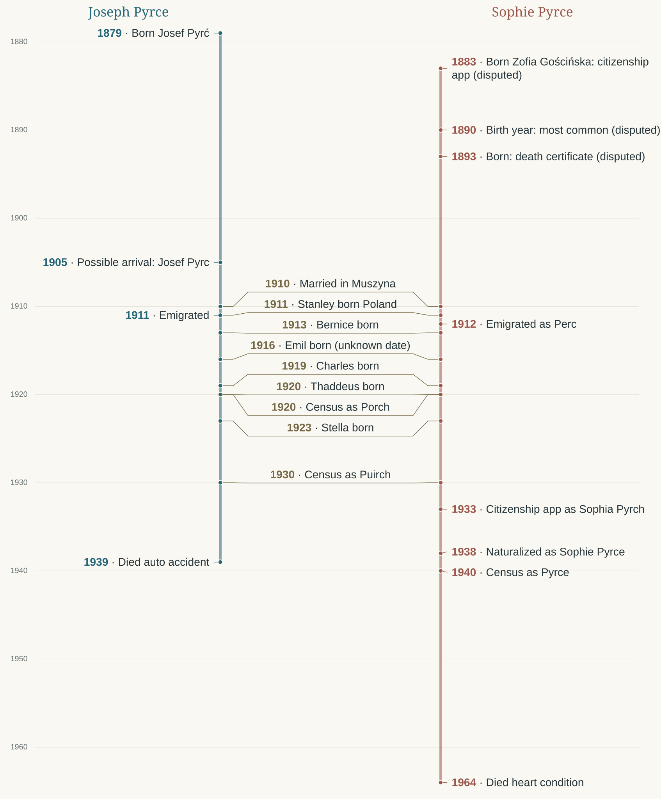

# The Pyrce family in America

Zofia (Sophie) Gościńska came from Muszyna, and Józef (Joseph) Pyrć may have come from there as well. The town is in the
historical region of Galicia, then part of Austria-Hungary and now in southern
Poland. 

[Open the timeline full size](./joseph_sophie_timeline_vertical.svg){target="_blank"}

## Arrival in the US

Records indicate that Sophie and Joseph were wed in Muszyna, Poland.  Joseph came to America first, and Sophie followed a year later with their newborn son, named "Stanisław" but later called "Stanley".  

A 
[Certificate of Arrival](../../media/StanleyPyrce/1936%20-%20Stanley%20Cert%20of%20Arrival.jpg)
issued for Stanley in 1936 records
his arrival on June 5, 1912, aboard the SS Königin Luise at the New York port of entry and lists his name
as **Stanislaw Perc**.  

The identifying number on this form, along with the date and ship, allowed the manifest to be found on Ellis Island.
The name on the entry manifest appears to be "Thanislav Perc" and Sophie was identified as "Sofia Perc".
He was age 1 in 1912, so he was born in 1911.  The origin of "Galicia, Muszyna" was misspelled as "Galiera, Muskyne".  

View the [ship manifest](../../media/SophieJoseph/1912%20-%20Entry%20Manifest%20line%205%20Sophie-Stanley.jpg) page 1
and [page 2](../../media/SophieJoseph/1912%20-%20Entry%20Manifest%20page%202.jpg) on
lines 5 and 6.
They voyaged on the German liner [SS Königin Luise](../../media/SophieJoseph/1912%20-%20SS%20Konigin%20Luise,%20later%20HMS%20Omar.jpg) ("Queen Louise").
(The Königin Luise was ceded to the United Kingdom after World War I as war reparations and renamed the HMS Omar.
There are food menus from the Königin Luise [available](https://commons.wikimedia.org/wiki/Category:Food_menus_of_the_Königin_Luise_%28ship,_1896%29), although I suspect these are for first or second class, not for steerage where Sophie and Stanley likely traveled.)

The [family chart S2, “Gościńscy z Wapiennego,”](/sources/#s2) says "Zofia née Gościńska emigrated to Chicago and married there". That conflicts with Sophie’s 1933 statement of a 1910 marriage in Muszyna (see below).

## Bernice’s baptism: 1913

Bernice, the first child born in America, has a 
[baptism certificate](../../media/SophieJoseph/1913%20-%20Bernice%20Baptism%20Certificate.jpg)
giving her birth date as August 7, 1913.  This
lists her name as "Bernice Pyrc" and her parents as "Joseph Pyrc" and "Sophia Goscinski".  
(It’s curious that Sophia's name is given as Goscinski rather than the more appropriate Goscinska.)
Her name is given as "Bernice" rather than the name "Bronisława" used in the Polish
genealogical charts.  

She was baptized at St. Casimir, a church founded in 1890 by Polish immigrants in the Little Village neighborhood.  The church
still exists (although the current building was built between 1917 and 1919) but is now named [Mother of the Americas](https://www.motheroftheamericas.org/english.html?locale=en) after parishes merged, reflecting a changed ethnic population.
The building is in the [Polish cathedral style](https://en.wikipedia.org/wiki/Polish_cathedral_style).

## Thaddeus’s birth certificate: 1920

Tadeus/Thaddeus/Ted, the family's fourth child, has his 1920
[birth certificate](../../media/Ted/1920%20-%20Thaddeus%20Birth%20Certificate.jpg)
available.
This gives Polish names for his parents:  "Joseph Pyrc" and "Zofia Goscinska".  It identifies
Joseph as 37 and Zofia as 33.  Ted's name is the Polish version, "Tadeuss Joseph Pyrc".
It identifies them as living on 2127 S. Fairfield Avenue in Chicago.

A correction to this birth certificate was filed in 1936, 16 years later, changing his name
to Thaddeus Mathew Pyrch and his father to Joseph Pyrch, effectively changing the name from "Pyrc" to
"Pyrch".  (It’s curious that his middle name was changed as well.)
View the [birth certificate correction](../../media/Ted/1936%20-%20Thaddeus%20Birth%20Cert%20Correction.jpg).

Another child, Emil, died very young and there are no dates available for him.

## US Census, 1920:  Porch?

General searches in the 1920 Census with possible names (e.g., Perc, Pyrc, Pyrch, Pirc, Puirch, and Pyrce) did not
find a match.  However, an address for the family was identified from Thaddeus Pyrce’s birth certificate
that lists the family as living on 2127 South Fairfield Ave in Chicago at his birth in February 1920.  Using
that address, a five-person household was identified in unit 188 at that address that looks like a reasonable match.
The surname appears to read **Porch** but the handwriting is not completely legible.

View the [1920 Census](../../media/SophieJoseph/1920%20-%20Census%20as%20Porch.jpg) image.

### 1920 Household

| Line | Name as read | Relationship | Age as read | Birthplace recorded | Immigration year |
| --- | --- | --- | --- | --- | --- |
| 19 | Joe Porch | Head | 40 | Poland | 1911 |
| 20 | Sophia | Wife | 30 | Poland | 1910 |
| 21 | Louis | Son | 1 plus | Illinois | — |
| 22 | Bertha | Daughter | 6 | Illinois | — |
| 23 | Stanley | Son | 8 | Illinois | — |

Both parents have Polish recorded as their mother tongue and Poland as their parents’ birthplace. Joe is recorded as a worker in a "wagon company" (not completely legible); Sophia’s occupation is “none.” Their citizenship entries appear to be Pa (papers filed) and Al (alien), respectively. The page does not establish a Muszyna birthplace.

There was another child, Emil, who died when very young.  His birthdate is not available, but it is suspected to be 
between Bernice and Charles because of the long span of years between their births.  This is conjecture.

### Comparison with the Pyrce family

The exact address, two Polish-born parents, the given names Joe/Sophia/Stanley, the size of the household, and the children's approximate age pattern make this a strong match.

- **Joe/Joseph:** age 40 is close to the family’s conflicting 1879/1881 birth accounts. Immigration in 1911 agrees with Sophie's later citizenship statement.
- **Sophia/Sophie:** age 30 agrees with the approximate 1890 birth year in the 1930 and 1940 censuses, while differing from the 1883 account. The immigration year 1910 conflicts with her later statement of continuous residence beginning in May 1912.
- **Stanley:** age 8 agrees with November 5, 1911, but **Illinois is explicitly recorded**, conflicting with his Poland birthplace. 
- **Bertha/Bernice:** age 6 is compatible with the August 1913 family birth date. The different given name remains unexplained; the image does not say Bernice.
- **Louis/Charles Lewis:** Louis is a plausible name connection to Charles Louis in Sophie's citizenship statement, but the image does not call him Charles. His age is written as 1 plus a fraction of a year. 
- **Thaddeus:** the family's February 17/19, 1920 birth accounts place him after the official census date, so his absence is expected.

## US Census, 1930:  Puirch

The 1930 U.S. Census 
records the family as **Puirch**.
“Puirch” may be a spelling used by the family or an enumerator’s invention.  There is no other
documentation that uses this name.

**Address:** 2406 South Spaulding Avenue, Chicago
**Enumeration date:** April 15, 1930

| Name recorded  | Relationship to Joseph | Age | Marital status | Birthplace | Occupation or school attendance |
| -------------- | ---------------------- | --: | -------------- | ---------- | ------------------------------- |
| Joseph Puirch  | Head                   |  51 | Married        | Poland     | Laborer, steel factory          |
| Sophie Puirch  | Wife                   |  40 | Married        | Poland     | Laborer, pie factory            |
| Stanley Puirch | Son                    |  17 | Single         | Poland     | Attending school |
| Bernice Puirch | Daughter               |  15 | Single         | Illinois   | Attending school |
| Charles Puirch | Son                    |  12 | Single         | Illinois   | Attending school |
| Thadeus Puirch | Son                    |  10 | Single         | Illinois   | Attending school |
| Stella Puirch  | Daughter               |   6 | Single         | Illinois   | Attending school |

Stella in the 1930 Census is Stephanie in the later documents.

- Joseph’s occupation is recorded as laborer in a steel factory; Sophie’s as laborer in a pie factory.
- The family **owned the home**, with a recorded value of **$3,000**.
- The household reported **no radio**.
- Joseph’s age at first marriage was recorded as **33**; Sophie’s as **20**.
- Both parents’ birthplaces were recorded as **Poland for every household member**.
- Joseph, Sophie, and Stanley were recorded with **Polish** as their native language.

### Immigration and citizenship

| Person  | Immigration year recorded | Citizenship notation | Meaning                         |
| ------- | ------------------------: | -------------------- | ------------------------------- |
| Joseph  |                      1911 | Pa                   | First naturalization papers     |
| Sophie  |                      1905 | Al                   | Alien, the census’s terminology |
| Stanley |                      1925 | Al                   | Alien, the census’s terminology |

View the [1930 census image](../../media/SophieJoseph/1930%20-%20Census%20as%20Puirch.jpg).

## Possible naturalization records for Joseph

The [Cook County naturalization declarations database](https://services.cookcountyclerkofcourt.org/nr/) contains possible matches. Neither entry below has been established as Joseph’s record.  Neither record is totally convincing.
Copies of these documents have not been obtained.

| Name in the index | Details in the entry | Why the identification is uncertain |
| --- | --- | --- |
| Frank Pyrch | “Musina,” “Poland - Austria”; born 1884; arrived 1897; declaration dated 1917 | The birthplace and surname may be relevant, but the given name, birth year, and arrival year differ from the family accounts. |
| Josef Pyrcioch | “Lagorzany,” “Austria”; born 1894; arrived 1911; declaration dated 1915 | The given name and reported arrival year match, but the surname, birth year, and birthplace differ. “Lagorzany” may be a reading of “Zagorzany”; this has not been confirmed. |

The second entry gave an address of 1346 Walton St., Chicago. 

## Sophie’s 1933 and 1938 citizenship papers:  Pyrch

Sophie filed a 
[Statement of Facts to Be Used in Filing My Petition for Citizenship](../../media/SophieJoseph/1933%20-%20Citizenship%20Petition.png)
in 1933. Sophie gave her name as **Sophia Pyrch**, her residence as 2406
S. Spaulding Ave., and her continuous U.S. residence as beginning in May 1912.
She says she married Joseph in Muszyna on March 12, 1910, and that he arrived
in the United States in 1911. The form gave Joseph’s birth date as March 8,
1881; other family records give the year as 1879.

The statement lists five children. The handwritten entries give these dates
and places of birth (some handwriting is difficult to read):

| Name as written | Date and place in the statement | Original Polish form |
| --- | --- | --- |
| Stanley John | November 5, 1911, Poland | Stanisław |
| Bernice Rose | August 1, 1914, Chicago | Bronisława |
| Charles Lewis | May 4, 1919, Chicago | Karol |
| Taddeus Matthew | February 19, 1920, Chicago | Tadeusz |
| Stella | June 16, 1923, Chicago | Stefania |

The statement uses Americanized forms alongside the Polish names. Some dates differ from the charts: Karol’s birth year is 1917 in the tree but 1919 for Charles in this statement; Bronisława’s is 1913 in the tree but 1914 for Bernice here. 

Sophie became a [citizen on March 22, 1938](../../media/SophieJoseph/1938%20-%20Naturalization%20-%20Front.tif).
The [reverse of her naturalization record](../../media/SophieJoseph/1938%20-%20Naturalization%20-%20Back.tif)
records a name change to **Sophie Pyrce**. The
family lived at 2406 S. Spaulding when Sophie filed her 1933 statement but was living at
4307 South Sawyer Ave. in 1938.

## Joseph's death

Joseph died on December 16, 1939.  His death certificate is in the name "Joseph Pyrch", and is certificate number 0034623
in Cook County, Illinois.  (I have not been able to obtain a copy of the death certificate from
the county.)
Joseph's [tombstone](https://www.findagrave.com/memorial/270123521/joseph-pyrce) gives his name as "Joseph Pyrce".

Curiously, the birth date on his tombstone appears altered. 

## 1940 Census:  Pyrce

| Name            | Relationship to Sophie | Age recorded | Marital status | Birthplace | Occupation or activity                     |
| --------------- | ---------------------- | -----------: | -------------- | ---------- | ------------------------------------------ |
| Sophie Pyrce    | Head                   |           50 | Widowed        | Poland     | Keeping house                              |
| Stanley Pyrce   | Son                    |           26 | Single         | Poland     | Lathe worker, valves and plumbing supplies |
| Bernice Pyrce   | Daughter               |           24 | Single         | Illinois   | Occupation unclear; mail-order house       |
| Charles Pyrce   | Son                    |           22 | Single         | Illinois   | Machine oiler, printing shop               |
| Thaddeus Pyrce  | Son                    |           20 | Single         | Illinois   | Office boy, printing shop                  |
| Stephanie Pyrce | Daughter               |           16 | Single         | Illinois   | Student; no occupation listed              |

- Address: 4307 South Sawyer Avenue, Chicago
- The household **owned its home**, valued at **$2,500**.
- Sophie and Stanley have citizenship code **“PA,” indicating first naturalization papers**.

[Original 1940 census sheet](../../media/SophieJoseph/1940%20-%20Census%20as%20Pyrce.jpg).

## Stanley Pyrce records:  Perc, Pyrc, Pirc, Pyrch, Pyrce

Stanley, the first child, was born in Poland.  His recorded names vary widely.

- His name was **Stanislaw Perc** in the manifest on arrival at Ellis Island, as previously mentioned.
- A [Certificate of Arrival](../../media/StanleyPyrce/1936%20-%20Stanley%20Cert%20of%20Arrival.jpg) dated 1936 attests that Stanley was born on November 5, 1911, and arrived in New York on June 5, 1912. His name is listed as "Perc, Stanislaw".
- A [Declaration of Intention](../../media/StanleyPyrce/1936%20-%20Stanley%20Declaration.jpg) to gain citizenship for Stanley is dated May 1936.  This lists his birthplace as Muszyna, Poland, and his birth date as November 5, 1911.  It gives several alternative names:  Stanley John Pyrc, Stanley John Pyrch, or S. J. Pirc, with "Pyrc" being the name he signed.
- His [Petition for Naturalization](../../media/StanleyPyrce/1936%20-%20Stanley%20Petition%20for%20Naturalization.jpg) is dated March 1941 and gives his name as Stanley Perc.
- His [1941 naturalization court card](../../media/SophieJoseph/1941%20-%20Stanley%20Pyrce%20Court%20Naturalization%20Card.jpg) records him as **Stanley Pyrce** and gives May 20, 1941, as the date of admission.
- A [1943 pay envelope](https://archive.pyrce.org/#album=1BBN0wvrVgRiKfmurPiiYDShYqHR3hoyI&photo=1RwdAX1K6FQ6R59PHhA3gqM8LM0_K-Rx1) from the Crane Company gives his name as "Stanley Pyrc." This may reflect a spelling used when he began working there, possibly more than a decade earlier.
- His [1944 military service record](https://archive.pyrce.org/#album=1BBN0wvrVgRiKfmurPiiYDShYqHR3hoyI&photo=1Ww_jruBHIoVC6f8dvYVI-lkqz9Regz-V), beginning in January 1944, gives his name as "Pyrce."  (It also says that he was born in the US, but this is incorrect.)

## 1950 census — Pyrce

**Address:** 4309 South Sawyer Avenue, Chicago

| Name            | Relationship to Sophie | Age recorded | Marital status | Birthplace | Occupation                                 |
| --------------- | ---------------------- | -----------: | -------------- | ---------- | ------------------------------------------ |
| Sophie Pyrce    | Head                   |           58 | Widowed        | Poland     | Keeping house                              |
| Bernice Pyrce   | Daughter               |           33 | Never married  | Illinois   | Office worker                              |
| Charles Pyrce   | Son                    |           30 | Never married  | Illinois   | Truck driver, printing press business      |
| Thaddeus Pyrce  | Son                    |           29 | Never married  | Illinois   | Elevator operator, printing press business |
| Stephanie Pyrce | Daughter               |           25 | Never married  | Illinois   | Office work, electric appliances business  |

All three sons had served in the military in World War II, and Stanley had died in Italy.

### Employment and citizenship details

- Sophie is recorded as **naturalized**.
- All four children reported **40 hours of work during the previous week**.
- Bernice’s industry appears to read **“Lamp Buyers”**, but that handwriting remains uncertain.
- The automated name index misread Sophie’s name as **“Cyree Sophic.”**

View the [1950 Census](../../media/SophieJoseph/1950%20-%20Census%20as%20Pyrce.jpg), lines 4-8.

Note that the 1950 Census is the last that is publicly available.

## Sophie's death

Sophie died in 1964.  Her [death certificate](../../media/SophieJoseph/1964%20-%20Death%20Certificate.tif) gives her birth year as 1893, which is significantly
later than the years given in other records.

## How did the name become "Pyrce"?

|Name|Date|Record|
|----|----|------|
|Pyrć|1910s|Polish records|
|Perc|1912|Attested in 1936 Certificate of Arrival for Stanley|
|Perc|1912|Ellis Island ship's manifest for US entry for Sophie and Stanley|
|Pyrc|1913|Bernice's baptismal certificate|
|Pyrcioch?|1915|Possible Naturalization Declaration of Intention for Joseph|
|Pyrc|1920|Ted's birth certificate|
|Puirch|1930|Census record; may be an error|
|Pyrch|1933|Sophie's Citizenship application|
|Pyrch|1936|Ted’s birth certificate correction|
|Pyrc|1936|Stanley’s Declaration of Intent alternative|
|Pirc|1936|Stanley’s Declaration of Intent alternative|
|Perc|1936|Stanley’s Declaration of Intent alternative|
|Pyrce|1938|Sophie's Naturalization, name change|
|Pyrch|1939|Joseph’s death certificate|
|Pyrce|1939|Joseph’s tombstone|
|Pyrce|1940|Census record|
|Pyrc|1943|Stanley's pay envelope; may represent name on initial employment|
|Pyrce|1944|Stanley's military service certification|
|Pyrce|1950|Census record|

It is purely conjecture, but the pronunciation of the Polish diacritic "ć" in the original name may have posed a challenge from the
time of immigration.  The Polish pronunciation of the name **Pyrć** is **pirts**, but that is not how this is pronounced in English once
the nonexistent diacritic is removed.  Variations that preserved the original pronunciation may have been tried
(e.g., "Puirch", "Pyrch") until finally
a minimal change that didn't sound foreign (or at least not Polish) was settled on.
It is notable how fluid names were for the family, both first names and surnames.  
All of these changed a number of times.
This is understandable in the early 1900s when there was less bureaucracy, records
were handwritten, and there were few, if any, robust error-correction procedures.

Ted Pyrce attributed the final name change to embarrassment over the name sounding “like the fish.” This is a family recollection.

## Birth dates by source

Census cells show **approximate birth year (recorded age)**. Approximate years generally use census year minus age and may be one year earlier. The 1920 census reference date was January 1; Louis’s approximate 1918 birth year reflects the recorded age of one year plus an unclear fraction. 

"-" indicates that the person was not living at that time.

| Person | 1920 census | 1930 census | 1940 census | 1950 census | 1933 statement | Other | Gravestone |
| --- | --- | --- | --- | --- | --- | --- | --- |
| Joseph | c. 1880 (40) | c. 1879 (51) | — | — | 8 Mar 1881 | | 1879 |
| Sophie | c. 1890 (30) | c. 1890 (40) | c. 1890 (50) | c. 1892 (58) | 1883 | 1893 [¹](#note-1) | 1 May 1883 |
| Stanley | c. 1912 (8) | c. 1913 (17) | c. 1914 (26) | — | 5 Nov 1911 | | 5 Nov 1911 |
| Bernice | c. 1914 (6) | c. 1915 (15) | c. 1916 (24) | c. 1917 (33) | 1 Aug 1914 | 1913 [²](#note-2) | 7 Aug 1913 |
| Charles | c. 1918 (1+) | c. 1918 (12) | c. 1918 (22) | c. 1920 (30) | 4 May 1919 | | 4 Nov 1917 |
| Thaddeus | — | c. 1920 (10) | c. 1920 (20) | c. 1921 (29) | 19 Feb 1920 | 1920 [³](#note-3) | 17 Feb 1920 |
| Roberta | — | c. 1924 (6) | c. 1924 (16) | c. 1925 (25) | 16 Jun 1923 | | 16 Jun 1923 |

**1.** Sophie's birth year is given as 1893 in her death certificate.  This can be seen in the family archive.

**2.** Bernice's birth year is given as 1913 in a baptism certificate, available in the family archive.

**3.** Birth certificate date.

## Immigration records and unresolved conflicts

- The 1913 passenger manifest for the S.S. *Kaiser Wilhelm II*, sailing from Bremen and arriving February 4, 1913, has an entry for Zofia Goscinska, age 18. It gives Muszyna as her last residence, names Jozef Goscinski as the husband she was joining, and gives Sioux City, Iowa, as her destination.  Muszyna was a small community of about 3,000 in 1913, so it is surprising that there should be another couple with such similar names.  The Polish records in the Goscinski family tree indicate that Sophie had a brother named Jozef, although those records do not indicate that he immigrated. It is possible that this was his wife joining him in America. Sophie had another brother, Andrew, who is recorded in the Polish family tree as having emigrated to Chicago at an unknown date, and there are photos of him in the collection.

- A separate manifest records a Josef Pyrc, age 23, arriving in New York aboard the S.S. *Pretoria* on December 13, 1905. The name and approximate age make him a possible match for Joseph, but the 1933 statement gives Joseph’s arrival as 1911. The 1905 entry should therefore remain a possible earlier arrival, not be assigned to him as fact. View the [1905 manifest, line 5](../../media/SophieJoseph/1905%20-%20Josef%20Pyrc%20Pretoria%20Manifest%3F%20%28line%205%29.gif).

### Sophie’s birth year

The records give a significant range of dates.

|Estimated birth year|Document|
|----------|--------|
|1885|1912 New York Passenger Arrival list (age 27)|
|1890|1920 Census (30)|
|1890|1930 Census (40)|
|1890|1940 Census (50)|
|1892|1950 Census (58)|
|1883|1933 Citizenship Application|
|1883|1938 Naturalization Papers|
|1893|1964 Death Certificate|

## Addresses

Addresses recorded for the family are:

|Year|Address|
|----|-------|
|1920|2127 S. Fairfield Avenue, Chicago|
|1930|2406 South Spaulding Avenue, Chicago|
|1938|4307 South Sawyer Avenue, Chicago|

## Record references

- 1930 U.S. census population schedule, Chicago, Cook County, Illinois, sheet
  19-A, enumeration district 16-824, household at 2406 S. Spaulding Ave.;
  [archived census image](../../media/SophieJoseph/1930%20-%20Census%20as%20Puirch.jpg).
- Sophie Pyrch, “Statement of Facts to Be Used in Filing My Petition for
  Citizenship,” 1933, page 3; [archived statement](../../media/SophieJoseph/1933%20-%20Citizenship%20Petition.png).
- S.S. *Kaiser Wilhelm II* passenger manifest, arrival February 4, 1913, line
  2, Zofia Goscinska; [archived manifest](../../media/SophieJoseph/1913%20-%20Zofia%20Goscinska%20Manifest%20-%20line%202%3F.gif).
- S.S. *Pretoria* passenger manifest, arrival December 13, 1905, line 5, Josef
  Pyrc; [archived manifest](../../media/SophieJoseph/1905%20-%20Josef%20Pyrc%20Pretoria%20Manifest%3F%20%28line%205%29.gif).
- Sophie’s naturalization record, reverse, March 22, 1938;
  [archived naturalization reverse](../../media/SophieJoseph/1938%20-%20Naturalization%20-%20Back.tif).
- [Cook County Clerk of the Circuit Court: Naturalization Declarations of Intention](https://services.cookcountyclerkofcourt.org/nr/).
